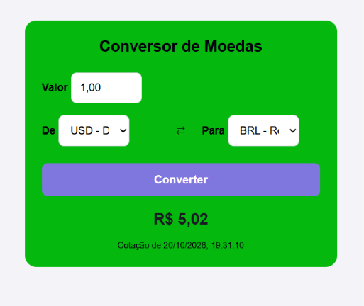

# Conversor de moedas



Conversor de moedas feito com HTML, CSS e JavaScript, usando a AwesomeAPI para buscar as cotações em tempo real.
Esse foi meu terceiro projeto e o primeiro em que o resultado não depende só do meu código. As cotações vêm de um servidor externo,
então precisei pensar no que acontece quando a resposta demora ou não chega.

[Acessar o conversor de moedas](https://hellenmayara.github.io/conversor-de-moedas/)

## Funcionalidades

- Conversão entre 10 moedas
- Cotações em tempo real pela AwesomeAPI
- Formatação do valor durante a digitação (ex: 12345 vira 123,45)
- Limite de 11 dígitos
- Botão para inverter as moedas
- Data e hora da cotação usada
- Mensagem de erro quando não é possível buscar a cotação
- Botão desativado durante a busca, evitando cliques repetidos
- Layout responsivo

## Tecnologias

- HTML5
- CSS3
- JavaScript (async/await e fetch)
- AwesomeAPI

## Como executar

```bash
git clone https://github.com/HellenMayara/conversor-de-moedas.git
```

Depois é só abrir o `index.html` no navegador.
Não é necessário instalar nada.

## Desafios enfrentados

**Os zeros no campo "Valor" se acumulavam** → Ao digitar, o campo ia enchendo de zeros à esquerda (000,50). A função completava com zeros para garantir os centavos, mas não removia os que sobravam. Consegui resolver limpando os zeros do começo, mas só quando restassem pelo menos três dígitos, para não perder o 0,05.

**O campo numérico que não aceitava formatação** → O `type="number"` não permite ponto de milhar, então troquei para `type="text"` e passei a controlar a formatação pelo JavaScript, usando `inputmode="decimal"` para o teclado continuar numérico.

**Lidar com o que não depende de mim** → Como as cotações vem de um servidor externo, a conversão pode falhar por motivos fora do meu controle. Usei `try/catch` para que, sem internet ou com a API fora do ar, o conversor mostre uma mensagem em vez de simplesmente não responder.

## Melhorias futuras

- Histórico de conversões
- Gráfico com a variação da moeda
- Mais moedas disponíveis
- Conversão automática ao trocar de moeda, sem precisar clicar

## Autoria

Feito por [Hellen Mayara](https://github.com/HellenMayara)